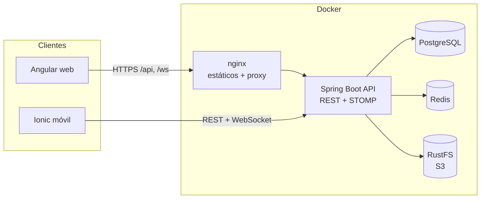
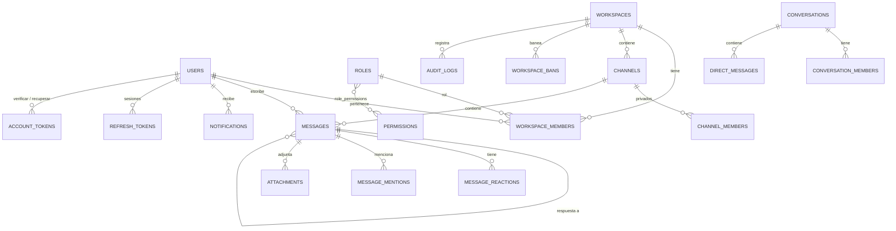
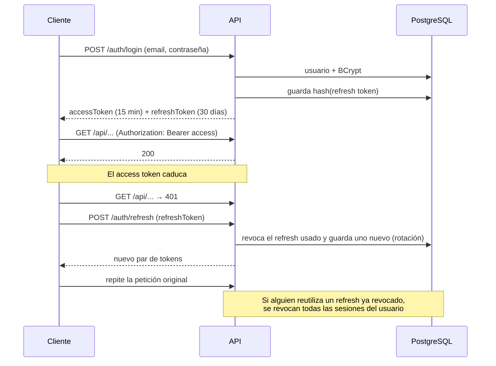
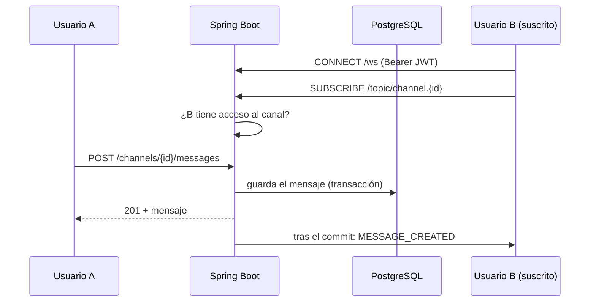
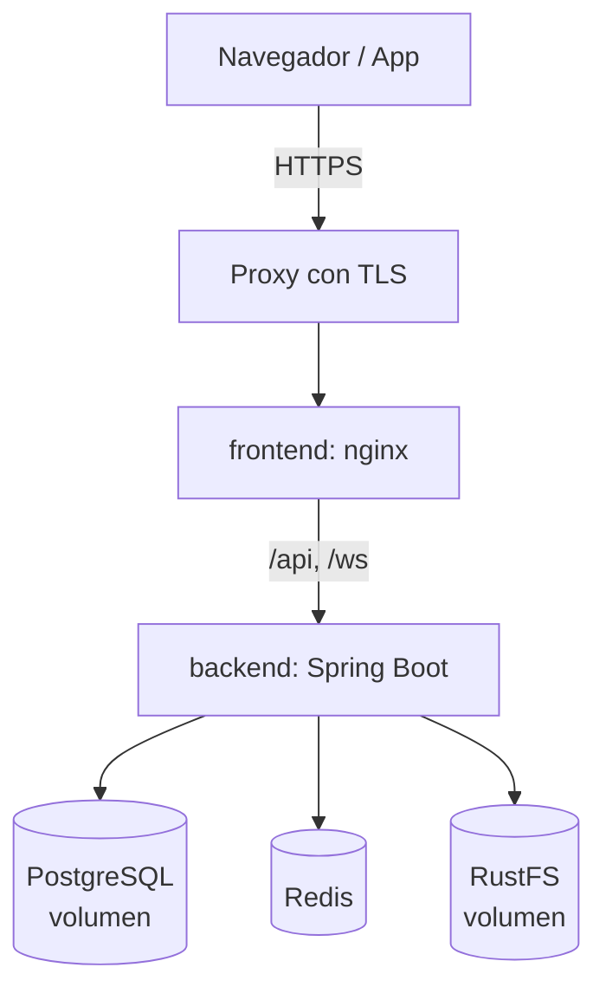

# Pulse

Plataforma de comunicación en tiempo real, inspirada en Slack y Discord: comunidades (workspaces), canales públicos y privados, mensajes en directo, mensajes privados, notificaciones, archivos y búsqueda.

Proyecto de portfolio con un backend en **Spring Boot**, una web en **Angular** y una app móvil en **Ionic**, las dos consumiendo la misma API REST y el mismo WebSocket.

- **Backend:** Java 21 · Spring Boot 3 · Spring Security + JWT · PostgreSQL + Flyway · Redis · WebSocket/STOMP · almacenamiento S3 (RustFS)
- **Web:** Angular 22 · signals · RxJS · STOMP
- **Móvil:** Ionic 9 · Angular · Capacitor
- **Calidad:** más de 110 tests de integración con Testcontainers · tests unitarios del frontend · GitHub Actions · Docker Compose

---

## Índice

1. [Qué hace](#qué-hace)
2. [Arquitectura](#arquitectura)
3. [Stack y por qué](#stack-y-por-qué)
4. [Estructura del repositorio](#estructura-del-repositorio)
5. [Arrancarlo en local](#arrancarlo-en-local)
6. [Variables de entorno](#variables-de-entorno)
7. [Base de datos](#base-de-datos)
8. [Autenticación](#autenticación)
9. [Tiempo real (WebSocket)](#tiempo-real-websocket)
10. [Redis](#redis)
11. [Archivos](#archivos)
12. [Seguridad](#seguridad)
13. [Testing](#testing)
14. [CI/CD](#cicd)
15. [Despliegue](#despliegue)
16. [Decisiones técnicas](#decisiones-técnicas)
17. [Limitaciones y mejoras futuras](#limitaciones-y-mejoras-futuras)

---

## Qué hace

| Área | Funcionalidades |
|---|---|
| Cuentas | Registro, login, logout, refresh token con rotación, verificación de email, recuperación de contraseña, cambio de contraseña, perfil |
| Workspaces | Crear, editar, borrar, invitar, roles (OWNER, ADMIN, MODERATOR, MEMBER, GUEST), expulsar, banear y desbanear |
| Canales | Públicos y privados, de texto o de anuncios (solo publican moderadores), archivar |
| Mensajes | Enviar, responder, editar, borrar (soft delete), reacciones con emoji, menciones `@usuario`, adjuntos |
| Tiempo real | Mensajes, ediciones, borrados, reacciones, "está escribiendo...", presencia online/offline, notificaciones |
| Mensajes privados | Conversaciones 1 a 1 y grupos pequeños, no leídos, tiempo real |
| Notificaciones | Menciones, mensajes privados, invitaciones, moderación; contador de no leídas |
| Búsqueda | Por texto (palabras a medias), workspace, canal, autor, fechas y menciones; paginada |
| Administración | Auditoría de acciones (quién, qué, cuándo) visible para owner y admins |

---

## Arquitectura

Un **monolito modular**: una sola aplicación Spring Boot organizada por dominios, no por capas técnicas. Para el tamaño del proyecto, los microservicios solo habrían añadido complejidad (red entre servicios, consistencia eventual, despliegues) sin ningún beneficio real.



Cada módulo del backend (`identity`, `users`, `workspaces`, `channels`, `messages`, `conversations`, `files`, `notifications`, `search`, `realtime`, `audit`) tiene su propio `controller`, `service`, `repository`, `entity`, `dto` y `mapper`. Las reglas que sigo:

- Un módulo usa a otro **solo a través de sus servicios**, nunca de sus repositorios o entidades.
- Los efectos secundarios van por **eventos de dominio** (`ApplicationEventPublisher`). Por ejemplo, `messages` no sabe que existen las notificaciones ni la auditoría: publica `UserMentionedEvent` o `MessageModeratedEvent`, y esos módulos escuchan.
- Los eventos que acaban en el WebSocket se envían **después del commit** (`@TransactionalEventListener(AFTER_COMMIT)`), para no anunciar nunca un mensaje que luego se deshace.

---

## Stack y por qué

| Tecnología | Para qué | Por qué |
|---|---|---|
| Spring Boot 3 + Java 21 | API | Ecosistema maduro para seguridad, datos y testing |
| PostgreSQL + Flyway | Datos | Modelo muy relacional (usuarios, roles, canales, mensajes). Flyway versiona el esquema; Hibernate solo lo valida (`ddl-auto=validate`) |
| Spring Security + JWT | Autenticación | Access token sin estado (15 min) más refresh token guardado (hasheado) para poder revocarlo |
| WebSocket + STOMP | Tiempo real | STOMP da temas (`/topic/channel.{id}`) y frames de suscripción que el servidor puede autorizar uno a uno |
| Redis | Presencia, rate limiting | Datos efímeros que cambian constantemente y no tienen sentido en Postgres |
| RustFS (S3) | Archivos | Almacenamiento de objetos compatible con S3. Ver [Archivos](#archivos) |
| MapStruct | DTOs | Evita escribir a mano el mapeo entidad → DTO |
| Testcontainers | Tests | Los tests usan un Postgres, Redis y RustFS reales, no mocks |
| Angular + signals | Web | Tipado fuerte; signals para el estado de la UI y RxJS para HTTP/WebSocket |
| Ionic + Capacitor | Móvil | Reutiliza Angular y TypeScript; Capacitor permite generar la app Android |

No he usado Elasticsearch: para este volumen, PostgreSQL con un índice trigram (`pg_trgm`) basta para buscar por texto parcial.

---

## Estructura del repositorio

```
.
├── backend/                 Spring Boot (Maven)
│   ├── src/main/java/com/pulse/
│   │   ├── common/          seguridad, errores, rate limiting, mail, configuración
│   │   ├── identity/        registro, login, tokens, recuperación de cuenta
│   │   ├── users/  workspaces/  channels/  messages/  conversations/
│   │   ├── files/  notifications/  search/  realtime/  audit/
│   ├── src/main/resources/db/migration/   migraciones Flyway (V1..V13)
│   └── src/test/java/       tests de integración (Testcontainers)
├── frontend/                Angular (core/ = servicios, features/ = pantallas)
├── mobile/                  Ionic + Capacitor
├── docker-compose.yml
├── .env.example
└── .github/workflows/ci.yml
```

---

## Arrancarlo en local

**Requisitos:** Docker Desktop. Para desarrollar sin Docker: Java 21, Maven y Node 24.

### Todo con Docker

```bash
cp .env.example .env        # y cambia JWT_SECRET por un valor aleatorio largo
docker compose up -d --build
```

| Servicio | URL |
|---|---|
| Web | http://localhost:4200 |
| API | http://localhost:8080/api/v1 |
| Swagger | http://localhost:8080/swagger-ui.html |

Si algún puerto ya está ocupado en tu equipo, cámbialo en `.env` (`DB_PORT`, `BACKEND_PORT`, `FRONTEND_PORT`...).

### Desarrollo

```bash
# Infraestructura
docker compose up -d postgres redis storage

# Backend (perfil dev: logs detallados y un JWT_SECRET de desarrollo)
cd backend && mvn spring-boot:run -Dspring-boot.run.profiles=dev

# Web (ng serve redirige /api y /ws al backend en el 8080)
cd frontend && npm install && npm start

# Móvil en el navegador (http://localhost:8100)
cd mobile && npm install && npx ng serve --port 8100
```

**Android:** `cd mobile && npx ng build --configuration production && npx cap add android && npx cap open android`. El build de producción apunta a `10.0.2.2:8080`, que es como el emulador de Android llega al ordenador.

Los correos (verificación y recuperación) se escriben en el log del backend mientras `MAIL_ENABLED=false`.

---

## Variables de entorno

Todas están en [`.env.example`](.env.example). Ningún secreto está en el código: sin `JWT_SECRET` el backend no arranca (salvo con el perfil `dev`).

| Variable | Descripción |
|---|---|
| `JWT_SECRET` | Clave para firmar los JWT (mínimo 32 caracteres). **Obligatoria** |
| `DB_NAME`, `DB_USERNAME`, `DB_PASSWORD` | PostgreSQL |
| `MINIO_ACCESS_KEY`, `MINIO_SECRET_KEY`, `MINIO_BUCKET` | Almacenamiento S3 |
| `CORS_ALLOWED_ORIGINS` | Orígenes permitidos (web y móvil) |
| `MAIL_ENABLED`, `SPRING_MAIL_*`, `MAIL_FROM`, `FRONTEND_URL` | Envío de correo y destino de los enlaces |
| `RATE_LIMIT_*`, `MAX_FAILED_LOGINS`, `LOGIN_LOCK_MINUTES` | Protección contra fuerza bruta |
| `*_PORT` | Puertos del host en Docker Compose |

---

## Base de datos

13 migraciones Flyway. Modelo principal:



Algunos detalles que importan:

- **Restricciones únicas para la concurrencia:** `(message_id, user_id, emoji)` impide reacciones duplicadas aunque lleguen a la vez; `(workspace_id, user_id)` en miembros y baneos; `direct_key` en conversaciones 1 a 1, para que dos personas que abren el chat a la vez no creen dos.
- **Soft delete** en mensajes (`deleted_at`): un mensaje borrado deja de aparecer, pero las respuestas no se rompen.
- **Índices** para lo que más se consulta: mensajes por canal y fecha, notificaciones no leídas (índice parcial), búsqueda trigram en el contenido.
- `audit_logs` **no tiene claves foráneas** a propósito: el historial tiene que sobrevivir a lo que describe.

---

## Autenticación



- Contraseñas con **BCrypt**; los refresh tokens y los tokens de email se guardan **hasheados** (SHA-256).
- En el frontend, un **interceptor** añade el token y gestiona el refresh: si varias peticiones fallan a la vez, todas esperan a una sola llamada de refresh.
- Cambiar o recuperar la contraseña **cierra todas las sesiones**.
- **Fuerza bruta:** límite de peticiones por IP en login/registro y bloqueo del email tras 5 fallos. Los emails que no existen también cuentan, para que no se pueda averiguar quién está registrado.

---

## Tiempo real (WebSocket)

Los mensajes **se guardan por REST** y el WebSocket solo **difunde** lo que ya está guardado. Así hay una única vía de validación y autorización, y ningún mensaje se pierde aunque el WebSocket falle.



| Destino | Contenido | Quién puede suscribirse |
|---|---|---|
| `/topic/channel.{id}` | mensajes, ediciones, borrados, reacciones, typing | quien tenga acceso al canal |
| `/topic/workspace.{id}.presence` | online/offline | miembros del workspace |
| `/topic/conversation.{id}` | mensajes privados | miembros de la conversación |
| `/topic/user.{id}` | notificaciones | solo ese usuario |
| `/app/channel.{id}/typing` | (cliente → servidor) "estoy escribiendo" | quien tenga acceso |

Un `ChannelInterceptor` valida el JWT en el `CONNECT` y **autoriza cada `SUBSCRIBE`**; cualquier otro destino se rechaza. El cliente descarta los duplicados por id (el mismo mensaje llega por REST y por WebSocket) y el aviso de "escribiendo" desaparece solo si no llega otra señal.

---

## Redis

Solo para lo que es efímero:

- **Presencia:** un *sorted set* por usuario, con una entrada por sesión WebSocket y su caducidad como puntuación. El servidor que tiene la sesión la renueva cada 30 s. Si ese servidor se cae, las sesiones caducan solas y el usuario pasa a offline. Un usuario sigue online mientras le quede alguna sesión (web y móvil a la vez).
- **Rate limiting:** contadores con caducidad, mediante un script Lua atómico (`INCR` + `EXPIRE`).

Si Redis no responde, el rate limiting **deja pasar** las peticiones: prefiero que funcione el login a bloquear a todo el mundo.

---

## Archivos

- Subida `multipart` a través del backend: imágenes, PDF, txt, docx y xlsx, hasta 10 MB.
- El tipo real se comprueba por los **primeros bytes** del archivo, no por lo que declara el cliente; renombrar un `.exe` a `.png` no sirve.
- La clave en el almacenamiento la genera el servidor (nunca el nombre que manda el usuario), y **cada descarga comprueba el acceso al canal**: conocer el id del archivo no basta.
- Un archivo subido pero aún no enviado solo lo ve quien lo subió; al borrar el mensaje se borran también sus archivos.

**¿Por qué RustFS y no MinIO?** La especificación pedía MinIO, pero su imagen ya no se publica en Docker Hub. RustFS implementa la misma API S3, así que el backend sigue usando el cliente Java de MinIO sin cambios. Cambiar de proveedor es solo cuestión de configuración.

---

## Seguridad

- **Toda la autorización se decide en el backend**; el frontend solo oculta botones. Cada comprobación está centralizada en servicios (`WorkspaceAuthorizationService`, `ChannelAccessService`...), no repartida por los controllers.
- **Jerarquía de roles:** solo puedes expulsar, banear o cambiar el rol de alguien por debajo de ti, y solo puedes dar roles inferiores al tuyo.
- **Datos ajenos:** los perfiles de otros usuarios no incluyen el email; los canales privados no aparecen en el listado de quien no es miembro.
- **Errores:** siempre con el mismo formato JSON y sin stack traces. Sin token se devuelve 401 y sin permiso 403.
- **XSS:** el contenido de los mensajes nunca se pinta como HTML.
- **SQL injection:** todas las consultas van parametrizadas (JPA y `NamedParameterJdbcTemplate`); en la búsqueda se escapan los comodines `%` y `_`.
- **Proxy:** detrás de nginx, la IP real se toma de `X-Forwarded-For`, pero solo cuando viene de una red interna.

---

## Testing

```bash
cd backend && mvn test                     # necesita Docker (Testcontainers)
cd frontend && npx ng test --watch=false
```

- **Backend (más de 110 tests):** casi todos son de integración, con **MockMvc** contra un PostgreSQL real (Testcontainers), más Redis y RustFS reales donde hace falta. Prueban comportamiento, no detalles internos. Por ejemplo:
  - un refresh token usado no sirve dos veces;
  - un moderador no puede expulsar a un admin;
  - quien sale de un workspace pierde el acceso a sus canales privados;
  - dos personas que abren el mismo chat a la vez acaban en una sola conversación;
  - un mensaje enviado por REST llega por WebSocket a los suscritos, y alguien de fuera no recibe nada.
- **Frontend:** tests unitarios del interceptor (añadir el token, refresh y reintento, logout si el refresh falla) y de los mensajes de error.

---

## CI/CD

[`.github/workflows/ci.yml`](.github/workflows/ci.yml) se ejecuta en cada push y pull request a `main`:

1. Backend: `mvn verify` (tests con Testcontainers).
2. Frontend: tests unitarios y build de producción.
3. Móvil: build de producción.
4. Construcción de las imágenes Docker, solo si todo lo anterior pasa.

Para que un PR no se pueda fusionar con tests en rojo, hay que activar en GitHub *Settings → Branches → Branch protection* para `main`, con estos *checks* como obligatorios.

---

## Despliegue



`docker-compose.yml` levanta los cinco servicios con healthchecks; el frontend espera a que el backend esté sano. Para producción faltaría un proxy con TLS delante, secretos gestionados fuera del `.env` y copias de seguridad de los volúmenes.

---

## Decisiones técnicas

- **Monolito modular en lugar de microservicios:** separación clara por dominios, sin el coste operativo de un sistema distribuido.
- **Escribir por REST y difundir por WebSocket:** una sola vía de validación; el WebSocket nunca es la fuente de verdad.
- **Eventos de dominio:** desacoplan notificaciones, auditoría y tiempo real del código que hace la acción.
- **Notificaciones y auditoría en la misma transacción que la acción** (`@EventListener` síncrono): o se guardan las dos cosas o ninguna. El envío por WebSocket, en cambio, va después del commit.
- **Subida de archivos a través del backend** en lugar de URLs prefirmadas: valido el contenido real y compruebo los permisos en cada descarga, a cambio de que los archivos pasen por el servidor.
- **Presencia en Redis con caducidad:** sobrevive a reinicios y a varias instancias del backend sin dejar usuarios "online" para siempre.
- **Búsqueda con SQL directo:** los filtros son opcionales y combinables, y la regla de visibilidad se lee entera en una sola consulta.
- **Tokens en `localStorage`:** sencillo y la sesión sobrevive a una recarga. La contrapartida es que un XSS podría leerlos; por eso el access token dura poco y Angular escapa todo el contenido. La alternativa sería guardar el refresh token en una cookie `HttpOnly`.
- **La app móvil copia la capa `core` de la web:** lo único que cambia es la URL del backend. Con más tiempo la convertiría en una librería compartida (por ejemplo, con un workspace de Nx).

---

## Limitaciones y mejoras futuras

- Los archivos subidos que nunca se envían no se limpian solos (faltaría una tarea programada).
- El avatar es una URL; no hay subida de imagen de perfil.
- Las conversaciones privadas no tienen indicador de "escribiendo" ni adjuntos.
- El endpoint de presencia consulta Redis una vez por miembro; en workspaces grandes convendría agrupar las consultas en una sola.
- Con varias instancias del backend, el broker STOMP en memoria debería sustituirse por uno externo (RabbitMQ o un *relay*) para que los mensajes lleguen a usuarios conectados a otra instancia.
- Faltan tests end-to-end del frontend (por ejemplo, con Playwright).
